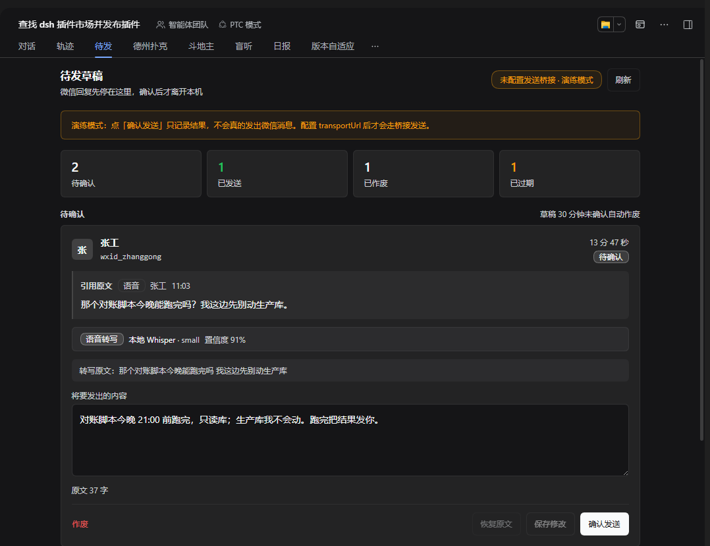

# dsh-wechat-draft-gate

[](https://github.com/dingchenhui0618-arch/dsh-wechat-draft-gate/actions/workflows/ci.yml)
[](LICENSE)

给 DeepSeek Harness 的**微信出站闸门**：Agent 写好的回复先落进本机「待发草稿箱」，保留引用原文与语音转写来源/置信度标注，允许人工改稿；只有面板点「确认发送」或在会话里发 `/send <id>` 才会离开本机。没人确认的草稿到点自动作废，并写清原因。

微信是对外真人渠道。一次误发无法撤回，所以这个插件只做一件事：**把「生成回复」和「真正发出」拆成两个阶段，中间必须有人点一下。**

## 灵感来源与原版

这个项目受 **[panqing0313/dsh-plugin-weixin](https://github.com/panqing0313/dsh-plugin-weixin)** 启发：它把个人微信接成 DSH 的远程入口，覆盖收发、图片文件、语音转写、`/new` `/list` `/use` 多会话，是一套完整、成熟的通道。

本项目**独立实现，不是 fork，也没有复制它的代码**。两者定位不同：

| 维度 | 原版 dsh-plugin-weixin | 本项目 dsh-wechat-draft-gate |
| --- | --- | --- |
| 定位 | 个人微信 ↔ DSH 的双向通道 | 只做**出站审批**的闸门 |
| 回复路径 | 按原版 README：微信里说一句 → Agent 执行 → 把结果回给你 | 回复先入草稿箱；**没有自动直发路径** |
| 草稿/确认 | 原版有 `/draft`（重要日子提醒的问候草稿，36 小时过期），属于特定功能 | 所有出站回复统一进闸门，人工确认后才发；默认 30 分钟未确认作废 |
| 语音标注 | 入站语音转文字后作为用户原话交给 Agent | 草稿额外保存转写来源、模型、置信度；低于阈值在面板标黄 |
| 引用原文 | 原版支持引用类消息（README 提到 `refermsg` 监听） | 草稿固定保存被回复的原话：类型、发送者、时间 |
| 发送实现 | 接微信 iLink Bot API | 不接微信；确认后 POST 给一个你配置的桥接端点，没配就是演练模式 |
| 范围 | 收发、媒体、ASR、多账号、记忆、群聊等 | 故意只做闸门，保持小而可审计 |

原版的完整能力值得直接使用；如果你要的是「所有回复先审后发」这一道闸，这个项目只补这一块。

> 说明：上表中关于原版的描述来自其公开 README（2026-11 读取）。原版仍在演进，以其仓库当前文档为准。

## 两级审批

```
微信消息 ──> DSH 会话 ──> Agent 回复
                              │
                              ▼
                    ┌──────────────────┐
                    │  待发草稿箱       │  第 1 级：自动落草稿
                    │  引用原文         │  可编辑、可作废
                    │  语音来源/置信度  │  默认 30 分钟过期
                    └────────┬─────────┘
                             │ 第 2 级：人工确认
                 ┌───────────┴───────────┐
                 ▼                       ▼
          面板「确认发送」          /send <id>
                 └───────────┬───────────┘
                             ▼
                   POST 桥接端点 ──> 微信
```

没有第三条发送路径。插件**不会**因为「回复写完了」「超时了」「重试了」而自行发出任何消息。

## 安装

```sh
dsh plugin --profile <你的 profile> add dsh-wechat-draft-gate
```

或从 GitHub 装：

```sh
dsh plugin --profile <你的 profile> add github:dingchenhui0618-arch/dsh-wechat-draft-gate
```

装好后重启 DSH，对话视图里出现「待发」Tab。

## 快速验证（不接微信）

插件默认是**演练模式**：确认动作会被完整记录，但不会发出任何网络请求。先跑一遍状态机：

```sh
node examples/bridge-stub.mjs          # 另开一个终端；不接微信，只收 POST 并写文件
```

在 `cordis.patch.yml` 里把 `transportUrl` 指向它：

```yaml
- insert:
    - id: dsh-wechat-draft-gate
      name: dsh-wechat-draft-gate
      config:
        draftTtlMinutes: 30
        lowConfidenceThreshold: 0.75
        transportUrl: http://127.0.0.1:47832/wechat/send
        # 不要把 token 写进仓库；用环境变量：
        transportTokenEnv: WECHAT_GATE_TOKEN
```

然后从本机模拟一条待发草稿：

```sh
curl -X POST http://127.0.0.1:3080/dsh-wechat-draft-gate/stage ^
  -H "content-type: application/json" ^
  -d "{\"chatId\":\"wxid_alice\",\"chatName\":\"Alice\",\"text\":\"明天下午三点见。\",\"quotedText\":\"我们明天见吧？\",\"quotedSender\":\"Alice\",\"quotedKind\":\"voice\",\"voiceSource\":\"local-whisper\",\"voiceModel\":\"small\",\"voiceConfidence\":0.86}"
```

打开「待发」Tab：能看到引用原文、语音来源与置信度、可编辑的正文。点「确认发送」后，`bridge-stub` 会打印并保存完整的出站载荷。

## 面板



- **待确认**：接收人、剩余时间、引用原文、语音来源/模型/置信度、可编辑正文、逐条错误提示
- **低置信度**：低于阈值时标黄「请核对原文」，但**不阻止**发送——决定权在人
- **处理记录**：已发送 / 已作废 / 已过期，附确认方式、时间、失败次数与作废原因
- **演练模式横幅**：没配 `transportUrl` 时常驻提示「确认只记录，不会真的发出」

## 命令

| 命令 | 作用 |
| --- | --- |
| `/send <id>` | 确认发送一条草稿；id 在「待发」面板可见 |
| `/drafts` | 列出待确认草稿（不发送） |

两个命令都不消耗模型对话。

## Agent 工具

`wechat_stage_draft`：让 Agent 把一条回复放进草稿箱，参数包括 `chatId`、`text`、`quotedText`、`voiceSource`、`voiceConfidence` 等。工具描述明确告诉模型：**这只是入草稿，不是发送**。工具返回草稿 id 与过期时间。

## 桥接契约

### 入草稿（本机 → 插件）

`POST /dsh-wechat-draft-gate/stage`

```json
{
  "chatId": "wxid_alice",
  "chatName": "Alice",
  "text": "要发出的回复",
  "quotedText": "对方原话",
  "quotedSender": "Alice",
  "quotedKind": "text | voice | image | file | unknown",
  "quotedAt": 1699999000000,
  "quotedMessageId": "msg-1",
  "voiceSource": "local-whisper",
  "voiceModel": "small",
  "voiceConfidence": 0.86,
  "voiceTranscript": "对方原话的转写"
}
```

返回 `201 {ok:true, draft}`。其余接口：`POST /edit`（`id`、`text`）、`POST /confirm`（`id`、可选 `text` 原子改稿后发送）、`POST /discard`（`id`、`reason`）、`GET /state`。

### 发送（插件 → 你的桥）

确认后，插件向 `transportUrl` 发一次 `POST`：

```json
{
  "version": 1,
  "kind": "wechat.outbound",
  "draftId": "wg_...",
  "idempotencyKey": "draft:wg_...",
  "chat": { "id": "wxid_alice", "name": "Alice" },
  "text": "最终确认的正文",
  "quoted": { "text": "...", "sender": "Alice", "at": 1699999000000, "kind": "voice", "messageId": "msg-1" },
  "voice": { "source": "local-whisper", "sourceLabel": "本地 Whisper", "model": "small", "confidence": 0.86, "threshold": 0.75, "lowConfidence": false, "transcript": "...", "note": "" },
  "origin": "bridge",
  "stagedAt": 1699999000000,
  "expiresAt": 1699999900000
}
```

请求头带 `idempotency-key: draft:<id>`（桥应按它去重）、`x-dsh-draft-gate: 1`，以及配置了 token 时的 `authorization: Bearer <token>`。桥返回任意 2xx 即视为送达；返回 `{"messageId":"..."}` 会把回执记进草稿。非 2xx 或超时 → 草稿保持待确认、记录失败次数，可重试。

`examples/bridge-stub.mjs` 是一份 20 行左右的参考实现，只落盘，不接微信。

## 配置

| 字段 | 默认 | 说明 |
| --- | --- | --- |
| `draftTtlMinutes` | `30` | 草稿未确认的存活分钟数 |
| `draftTtlMs` | 空 | 直接给毫秒；设置后覆盖 `draftTtlMinutes`（测试用） |
| `lowConfidenceThreshold` | `0.75` | 低于此值的语音置信度标黄 |
| `sweepIntervalMs` | `15000` | 过期扫描间隔；每次读取状态时也会先扫描 |
| `historyLimit` | `200` | 面板最多返回多少条处理记录 |
| `maxDrafts` | `500` | 草稿箱上限，超出时从最旧的已处理草稿开始清理 |
| `transportUrl` | `''` | 桥接端点；留空 = 演练模式 |
| `transportToken` | `''` | 直接给 token（不推荐入库） |
| `transportTokenEnv` | `''` | 从环境变量读 token（推荐） |
| `transportTimeoutMs` | `10000` | 发送超时 |
| `stateDir` | `$DSH_HOME/wechat-draft-gate` | 草稿与审计文件目录 |

## 过期与审计

草稿箱是 `drafts.json`（临时文件 + rename 原子替换）。每次状态变更另追加一行 JSONL 到 `ledger.jsonl`：

```
{"at":...,"action":"staged","id":"wg_...","chatId":"wxid_alice","status":"pending"}
{"at":...,"action":"expired","id":"wg_...","chatId":"wxid_alice","status":"expired","expiresAt":...}
```

`action` 取值：`staged` / `edited` / `sent` / `send-failed` / `voided` / `expired`。过期记录的 `status` 与 `expiresAt` 都在，原因同时写在草稿的 `voidReason.detail`（例如「超过 30 分钟未确认，自动作废」）。

`drafts.json` 损坏时会被改名为 `drafts.json.corrupt-<时间戳>` 保留现场，草稿箱从空开始，不阻塞插件加载。

## 语音置信度的诚实边界

**插件不计算置信度。** 它只接收桥接端给出的数字并做标注：

- `voiceConfidence` 接受 `0-1`，也接受 `1-100`（会自动除以 100）；
- 非数字或越界 → 置信度记为 `null`，面板显示「未提供置信度」，不会猜一个值；
- 低于阈值只标黄提示，**不拦截发送**；
- 来源名未知时保留原始字符串，不硬套成「本地 Whisper」。

转写文本与引用原文分别保存，面板会同时展示（相同时不重复）。

## 它不做什么

- **不登录微信**。没有扫码、没有 iLink/协议调用、没有账号凭据。
- **不做入站**。收消息、媒体下载、ASR、会话映射都属于桥接端；本插件只接收已经整理好的回复。
- **不做自动放行**。没有「白名单联系人自动发」这种开关——那会把唯一的闸门绕过去。
- **不绕过 DSH 权限层**。它只是出站链路的一环，不改变工具审批、文件权限或沙箱策略。

安全边界（端口暴露、token 存放、状态目录权限）见 [SECURITY.md](SECURITY.md)。

## 测试

```sh
npm test        # node --test，零依赖
npm run build   # 从 src/ 生成 lib/（CI 会检查 lib/ 与 src/ 一致）
```

测试覆盖：草稿状态机、过期与重载过期、确认/作废/重试、语音置信度归一化、落盘与损坏恢复、审计行、HTTP 路由、`/send` `/drafts`、Agent 工具、真实本地桥接 POST、超时、环境变量 token、卸载清理。

## 兼容性

宿主契约来自实测的 DSH `0.2.x`：`webServer.register({kind:'prefix'})`、`ctx.tools.register`、`ctx.commands.register`、`conversation.view` 槽位。宿主升级后如果 Tab 不出现，先看 DSH 控制台里的插件加载错误。

## 许可

MIT。代码为独立实现；原版项目仅作为方向参考，其代码未复制进本仓库。
